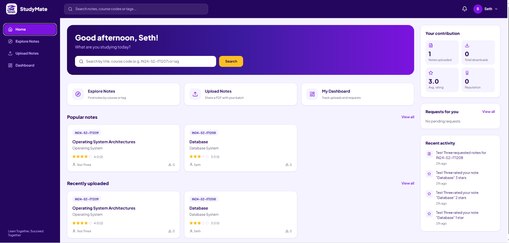
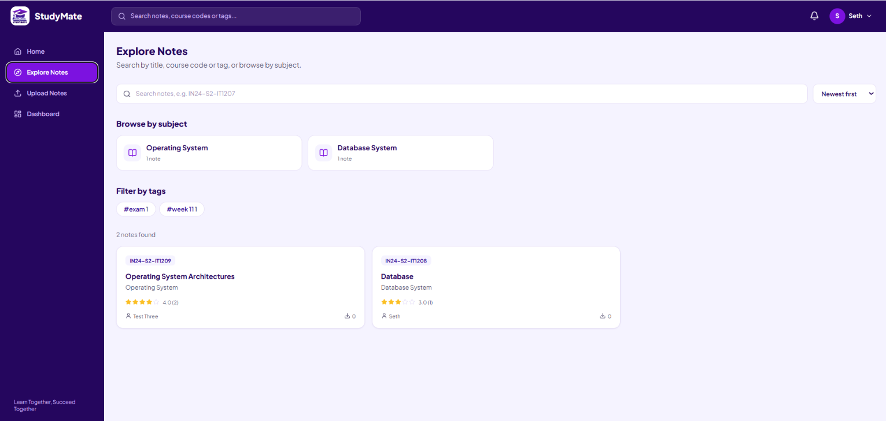
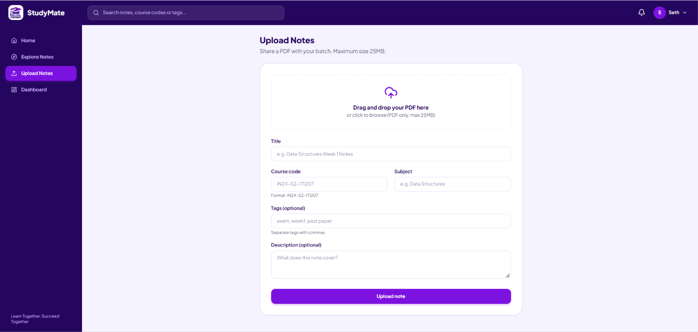
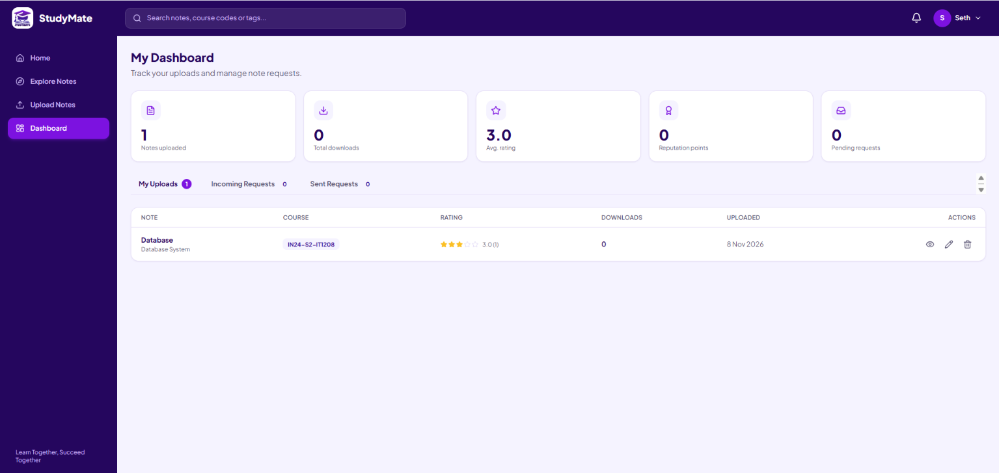

# StudyMate

A peer-to-peer note sharing platform for university students. Students upload lecture notes as PDFs, search and rate each other's notes, leave comments, and request notes from fellow students.

> **Learn Together, Succeed Together**

**Live demo:** [add your Vercel link here after deployment]

## Features

- Registration restricted to university emails (`@itum.mrt.ac.lk`), JWT login, forgot / reset password
- Upload PDF notes (max 25MB) with a course code, subject and tags
- Search by title, course code or tag, subject cards, multi-tag filters, newest / popular sorting
- Note hub with PDF preview, 1-5 star rating with breakdown, comments and download count
- Note requests with deadlines, urgent / overdue highlighting, and Fulfil / Close / Reopen actions
- In-app notifications for ratings, comments and requests
- Personal dashboard: manage uploads (edit / delete), incoming and sent requests, reputation points

## Tech stack

| Layer | Technology |
|---|---|
| Frontend | React (Vite), Tailwind CSS, React Router, Axios |
| Backend | Node.js, Express (MVC structure) |
| Database | MongoDB Atlas with Mongoose |
| File storage | Cloudinary |
| Authentication | JWT, bcrypt |

## Project structure

```
StudyMate/
├── client/              React frontend
│   └── src/
│       ├── api/         Axios instance
│       ├── components/  Reusable UI components
│       ├── context/     Auth context
│       ├── hooks/       Custom hooks
│       ├── pages/       Route pages
│       └── utils/       Helpers
└── server/              Express API
    ├── controllers/
    ├── middleware/
    ├── models/
    ├── routes/
    └── utils/
```

## Getting started

### Prerequisites

- Node.js 20 or newer
- A MongoDB Atlas cluster
- A Cloudinary account

### 1. Clone the repository

```bash
git clone https://github.com/[your-username]/StudyMate.git
cd StudyMate
```

### 2. Set up the backend

```bash
cd server
npm install
```

Create `server/.env` using `server/.env.example` as a guide:

| Variable | Description |
|---|---|
| `PORT` | API port (default 5000) |
| `MONGO_URI` | MongoDB Atlas connection string (include the `/studymate` database name) |
| `JWT_SECRET` | Long random string used to sign tokens |
| `CLOUDINARY_CLOUD_NAME` | Cloudinary cloud name |
| `CLOUDINARY_API_KEY` | Cloudinary API key |
| `CLOUDINARY_API_SECRET` | Cloudinary API secret |
| `CLIENT_URL` | Frontend URL (used in password reset links) |
| `EMAIL_USER`, `EMAIL_PASS` | Optional Gmail address and app password for reset emails. If empty, the reset link is printed in the server console |

Start the API:

```bash
npm run dev
```

### 3. Set up the frontend

```bash
cd client
npm install
npm run dev
```

Open http://localhost:5173

## API overview

| Area | Endpoints |
|---|---|
| Auth | `POST /api/auth/register`, `login`, `forgot-password`, `reset-password/:token`, `GET /api/auth/me` |
| Notes | `GET/POST /api/notes`, `GET /api/notes/subjects`, `GET /api/notes/tags`, `GET/PUT/DELETE /api/notes/:id`, `POST /api/notes/:id/rate`, `GET /api/notes/:id/download` |
| Comments | `GET/POST /api/notes/:id/comments`, `DELETE /api/notes/:id/comments/:commentId` |
| Requests | `POST /api/requests`, `GET /api/requests/incoming`, `GET /api/requests/sent`, `PATCH /api/requests/:id/status` |
| Users | `GET /api/users/me/stats` |
| Notifications | `GET /api/notifications`, `PATCH /api/notifications/read-all`, `PATCH /api/notifications/:id/read` |

All routes except register, login, forgot-password and reset-password require a `Authorization: Bearer <token>` header.

## Screenshots

| Home | Explore |
|---|---|
|  |  |

| Note hub | Dashboard |
|---|---|
|  |  |

## Author

Sethunima Rajapaksha · 24IT0526 · Fundamentals of Software Engineering
